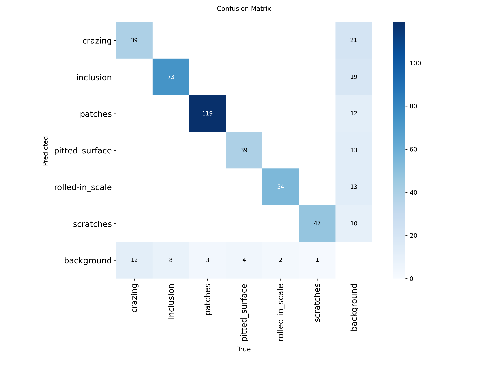
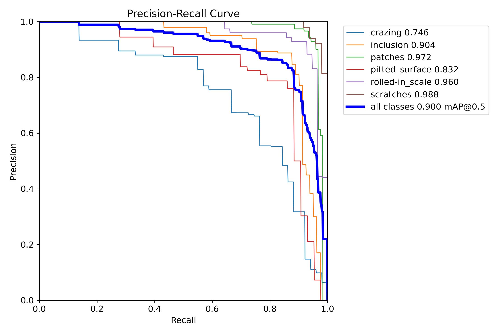
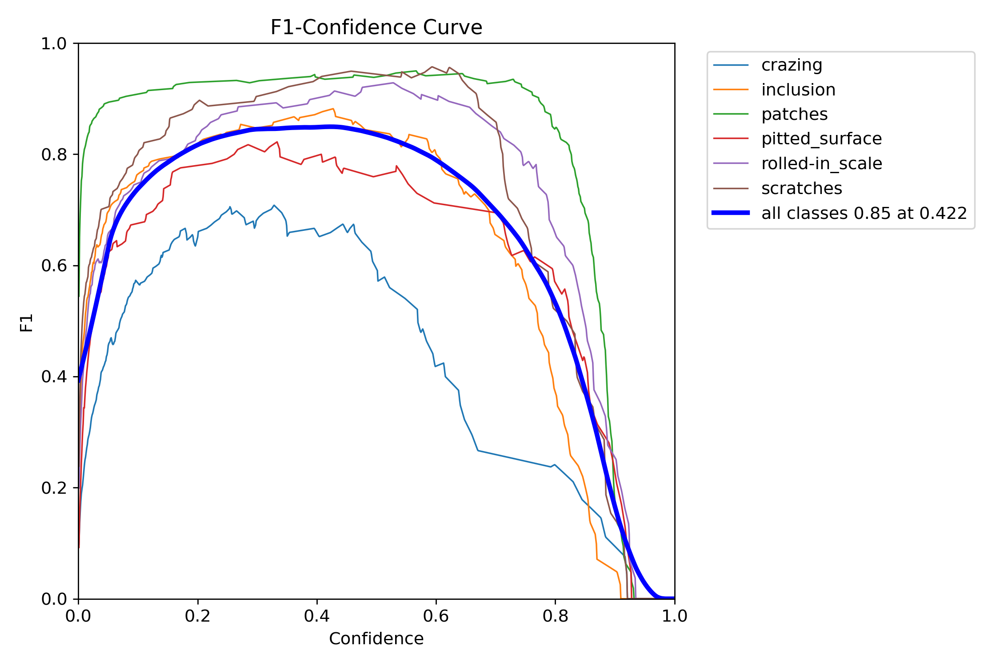

# Steel Surface Defect Detection with YOLOv8

## Project Overview
Automated defect detection system for steel manufacturing using YOLOv8.
The model classifies six types of surface defects from the NEU dataset,
enabling real-time quality control inspection without manual intervention.

## Dataset
| Property | Value |
|----------|-------|
| Source | NEU Surface Defect Database |
| Classes | 6 |
| Total images | 1,800 |
| Split | 70% train / 20% val / 10% test |

## Model
- Architecture: YOLOv8s
- Epochs: 100
- Image size: 640×640
- Framework: Ultralytics

## Results

| Metric | Value |
|--------|-------|
| mAP50 | 90.0% |
| mAP50-95 | 63.2% |

### Per-class Performance
| Class | AP50 |
|-------|------|
| crazing | 74.6% |
| inclusion | 90.4% |
| patches | 97.2% |
| pitted_surface | 83.2% |
| rolled-in_scale | 96.0% |
| scratches | 98.8% |

### Evaluation Plots




## Limitations
- Crazing class shows weaker performance due to low visual contrast.
- Model trained only on NEU dataset; may not generalize to other steel types.

## Future Work
- Expand with Severstal Kaggle dataset (12,000+ images)
- Experiment with larger YOLOv8 variants for improved accuracy
- Add real-time webcam inference support

## Live Demo
[](https://huggingface.co/spaces/kirkdokizelli/steel-defect-detection)

## Links
- **Model on Hugging Face:** https://huggingface.co/kirkdokizelli/steel-defect-yolov8
- **GitHub:** https://github.com/kirkdokizelli/steel-defect-detection

## Usage
```bash
pip install -r requirements.txt
streamlit run streamlit_app.py
```

---
*Developed as a pre-internship project exploring computer vision applications
in steel manufacturing quality control.*
